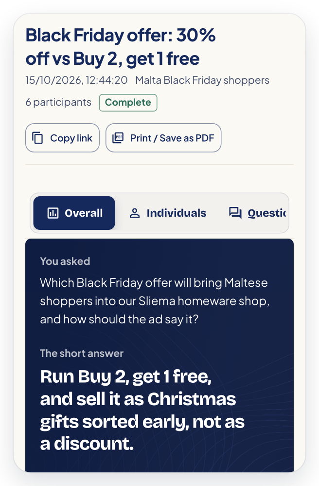
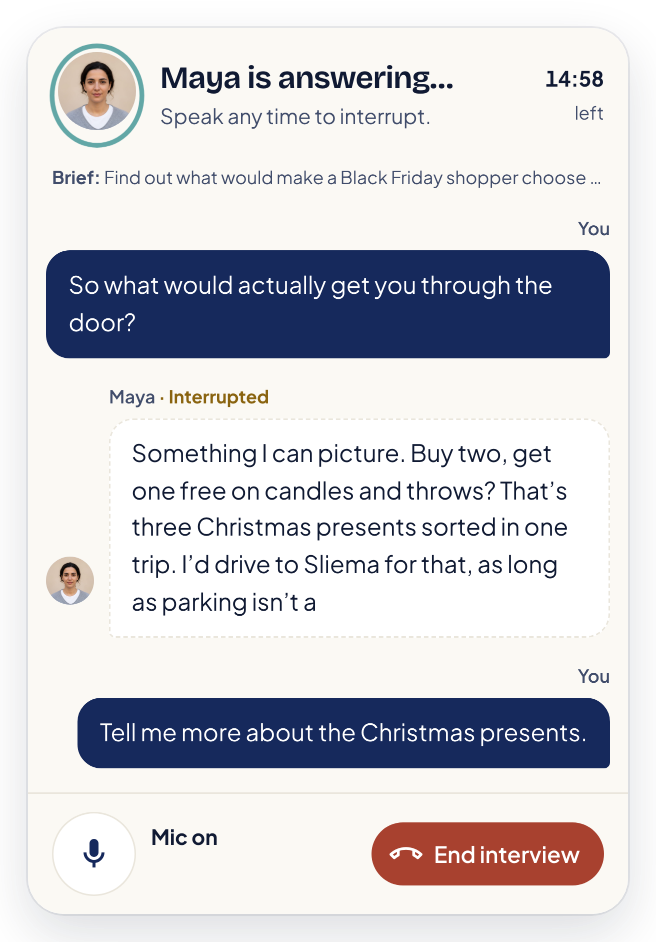
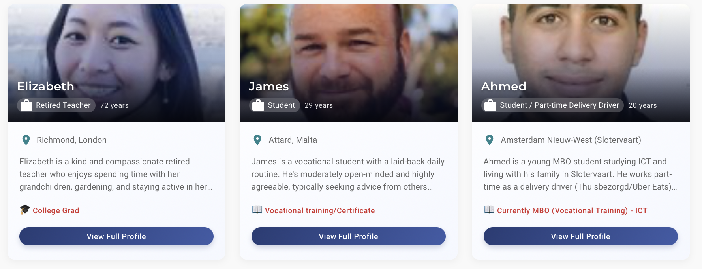
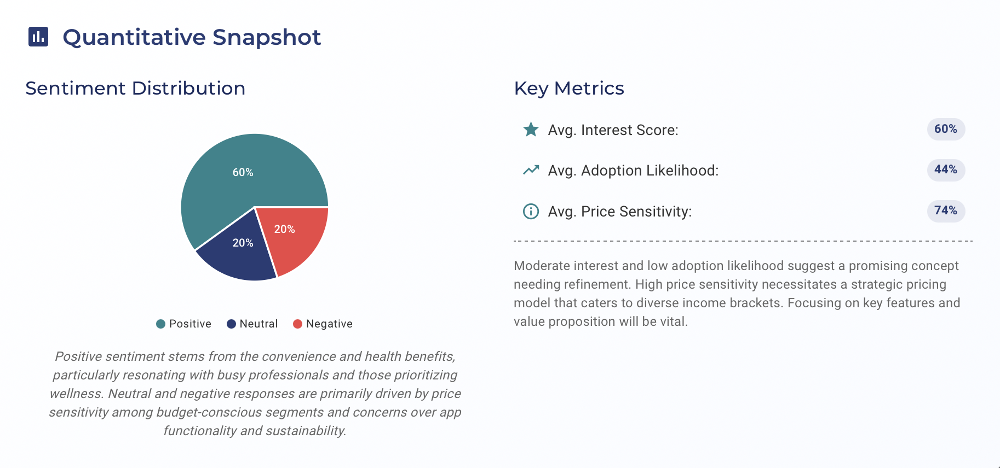

# Ask Your Audience

**Before you make the decision, Ask Your Audience.**

Ask Your Audience (AYA) gives product, marketing and research teams authentic audience feedback in minutes, not weeks, without leaving their AI assistant. AYA uses **Human Digital Twins**: AI built from deep profiling of real people, not synthetic personas. Each twin is built from 120+ data points collected through recorded interviews with a real person.

Connect your existing AYA account, pick one of your audiences, and AYA prepares a Concept Test or, where enabled for your account, an Image Ad Evaluator, Focus Group or Interview. You see the exact brief, participants and cost before anything runs, and you discuss the findings right in the chat.

Remote MCP server: `https://mcp.askyouraudience.ai/mcp` (Streamable HTTP, OAuth)

## See it

| A finished study | A one-to-one interview |
| :-: | :-: |
|  |  |

**Twins built from real people**



**Reports with the numbers behind the answer**



## What you can do

- **Concept Test**: see how your audience reacts to a product idea, proposition or message, with the reasons behind each reaction.
- **Image Ad Evaluator**: score a supplied ad or creative for a specific placement such as LinkedIn or Instagram.
- **Focus Group**: run a moderated discussion with six digital twins to surface objections and motivations.
- **Interview**: go deep one-to-one with a single twin on a topic you choose.
- **Your research, in chat**: browse your audiences, reopen saved studies and discuss findings without switching tools.

Image Ad Evaluator, Focus Group and Interview are available where enabled for your account.

## Who it's for

Product managers checking a feature before building it, marketers testing messaging before a campaign, founders validating a proposition before launch, and research teams that want a fast first read before commissioning fieldwork.

Because every twin starts with a real person, you hear reasons, objections and language that sound like your customers, not a generic persona. You pick the audience by country, age, occupation and more, and get qualitative, quotable evidence in minutes. Learn more at [askyouraudience.ai](https://www.askyouraudience.ai).

## Use it

| Where | How |
| :- | :- |
| **ChatGPT** | Create a custom app, as shown below |
| **Claude** (web, desktop, mobile) | Add a custom connector, as shown below |
| **Claude Code** | Install the plugin, as shown below |
| **Other MCP clients** (Cursor, VS Code, Codex and others) | Not yet available. Sign-in from these clients is not enabled yet. [Contact us](https://www.askyouraudience.ai/contact) for early access |

### Claude (web, desktop, mobile)

1. In Claude, open **Settings → Connectors → Add custom connector**.
2. Name it `Ask Your Audience`, enter `https://mcp.askyouraudience.ai/mcp` and leave the other settings as they are.
3. Choose **Add**, then **Connect**. Sign in to AYA and choose **Allow access**.

### ChatGPT

1. In ChatGPT, open **Settings → Apps → Advanced settings** and switch on **Developer mode**.
2. In **Settings → Apps**, choose **Create**. Name it `Ask Your Audience`, enter `https://mcp.askyouraudience.ai/mcp`, set Authentication to **OAuth** and choose **Create**.
3. Sign in to AYA and choose **Allow access**.

### Claude Code

Inside Claude Code (v2.1.275 or later):

```
/plugin install ask-your-audience --marketplace Ask-Your-Audience/askyouraudience
```

Or from your shell:

```
claude plugin marketplace add Ask-Your-Audience/askyouraudience
claude plugin install ask-your-audience@askyouraudience
```

Then run `/mcp`, choose **ask-your-audience** and select **Authenticate**. Your browser opens AYA so you can sign in and allow access. Claude Code receives the sign-in on port 47561, so keep that port free.

You need an [AYA account](https://www.askyouraudience.ai) with at least one audience. Connecting and preparing studies are free. A study uses AYA tokens from your existing balance only after you approve its quoted cost.

## Try asking

- "Prepare a Concept Test for this proposition with an audience in my AYA account."
- "Run a focus group with my UK audience about objections to a refundable cup deposit. Show me the questions and cost first."
- "Help me understand the findings from my completed AYA study."

## How a study runs

1. **Find an audience.** The assistant searches the audiences you already have in AYA.
2. **Prepare.** AYA returns the exact brief, the selected digital twins and the token cost. Nothing is charged.
3. **Approve.** You confirm the quote in the chat. Nothing runs without your explicit approval, and a quote expires after fifteen minutes.
4. **Run and read.** The study runs once. The assistant reports progress and then discusses the returned findings, citing the evidence.

Digital twin responses are simulated qualitative research. They are not a representative survey or a prediction of real-world outcomes.

## What's in this repository

This repository holds the listing package for Ask Your Audience. It contains no server code and no credentials.

| File | Used by |
| :- | :- |
| `skills/audience-research/SKILL.md` | Agent Skills: teaches an assistant how to run the research loop |
| `.claude-plugin/plugin.json`, `.claude-plugin/marketplace.json`, `.mcp.json` | Claude plugins and Claude plugin marketplaces |
| `plugin.json`, `mcp.json` | [Agent Plugins](https://agent-plugins.org) 1.0 clients |
| `server.json` | The [official MCP Registry](https://registry.modelcontextprotocol.io) and the directories that mirror it |
| `glama.json` | Glama ownership claim |

These files are generated from AYA's internal source. Please report problems to [support@askyouraudience.ai](mailto:support@askyouraudience.ai) rather than editing the files here.

## Support and policies

- Support: [askyouraudience.ai/contact](https://www.askyouraudience.ai/contact)
- Privacy policy: [askyouraudience.ai/privacy](https://www.askyouraudience.ai/privacy)
- Terms of service: [askyouraudience.ai/terms](https://www.askyouraudience.ai/terms)

The files in this repository are released under the MIT License. Use of the AYA service is governed by the AYA terms of service.
