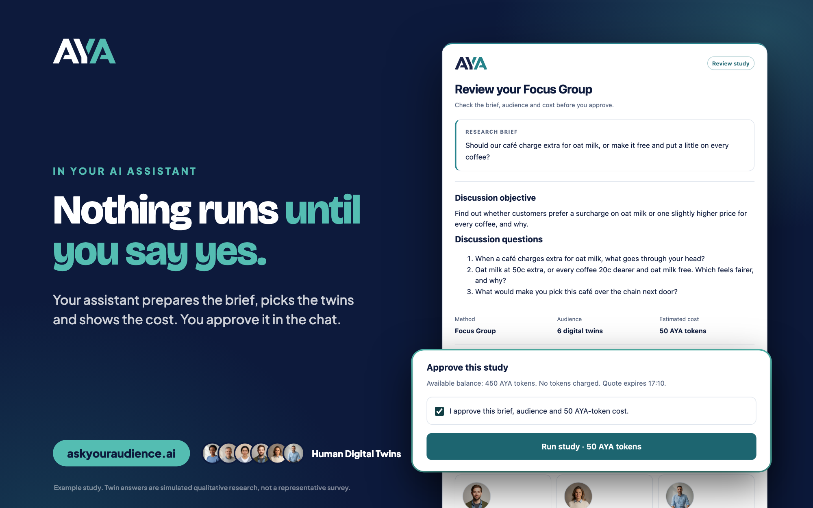
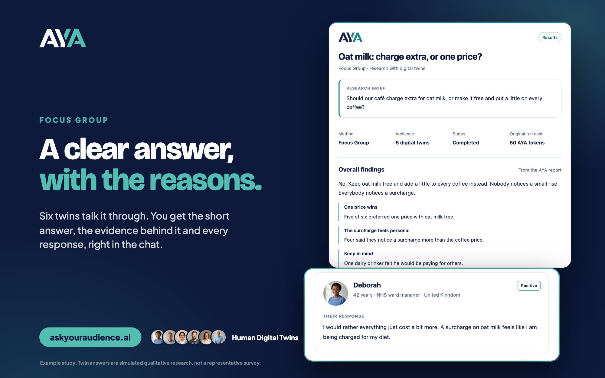
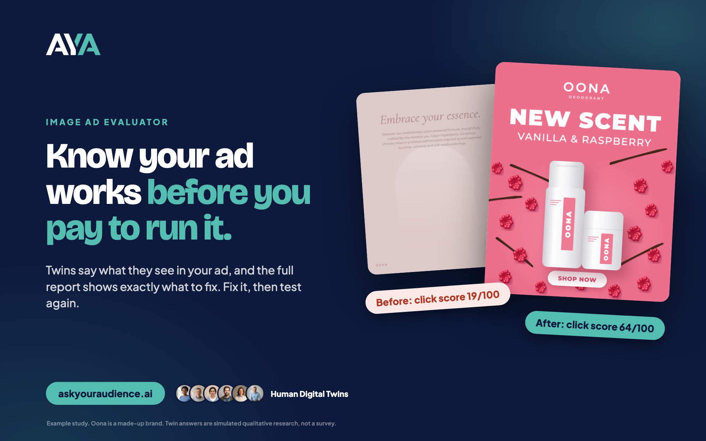

# Ask Your Audience

**Before you make the decision, Ask Your Audience.**

Ask **Human Digital Twins** what they think of your idea, message or ad without leaving Claude or ChatGPT. Every twin is built from a real person: recorded interviews and more than 120 data points on how they live, shop and decide. You get a clear answer, the reasons behind it and every response, in minutes rather than weeks.


Remote MCP server: `https://mcp.askyouraudience.ai/mcp` (Streamable HTTP, OAuth)

## What you can ask

- **Concept Test**: how your audience reacts to a product idea, offer or message, and why.
- **Focus Group**: six twins talk your question through. You get the short answer, the evidence and every response.
- **Image Ad Evaluator**: share an ad and see what twins take from it, how it scores and what to fix.
- **Interview**: one twin, one to one, with follow-up questions.

You choose the audience from those in your AYA account, by country, age, occupation and more. Image Ad Evaluator, Focus Group and Interview are available where enabled for your account.

## How a study runs

1. **Ask.** Describe your decision in the chat. Your assistant finds a matching audience in your AYA account.
2. **Check.** AYA returns the exact brief, the twins taking part and the cost in AYA tokens. Nothing is charged.
3. **Approve.** You confirm in the chat. Nothing runs without your approval, and a quote expires after 15 minutes.
4. **Read.** The study runs once. Your assistant discusses the findings and the evidence behind them, and links the full report in AYA.

| You approve every study | A clear answer, with the reasons |
| :-: | :-: |
|  |  |
| **Test an ad before you pay to run it** | **Ask one twin why** |
|  |  |

The screens show example studies. Oona is a made-up brand. Talking out loud with a twin is available in the AYA app.

## Set it up

| Where | How |
| :- | :- |
| **Claude** (web, desktop, mobile) | Add a custom connector |
| **ChatGPT** | Create a custom app |
| **Claude Code** | Install the plugin |
| **Other MCP clients** (Cursor, VS Code, Codex and others) | Not available yet. [Contact us](https://www.askyouraudience.ai/contact) for early access |

### Claude (web, desktop, mobile)

1. In Claude, open **Settings → Connectors → Add custom connector**.
2. Name it `Ask Your Audience`, enter `https://mcp.askyouraudience.ai/mcp` and leave the other settings as they are.
3. Choose **Add**, then **Connect**. Sign in to AYA and choose **Allow access**.

### ChatGPT

1. In ChatGPT, open **Settings → Apps → Advanced settings** and switch on **Developer mode**.
2. In **Settings → Apps**, choose **Create**. Name it `Ask Your Audience`, enter `https://mcp.askyouraudience.ai/mcp`, set Authentication to **OAuth** and choose **Create**.
3. Sign in to AYA and choose **Allow access**.

### Claude Code

Inside Claude Code (v2.1.275 or later):

```
/plugin install ask-your-audience --marketplace Ask-Your-Audience/askyouraudience
```

Or from your shell:

```
claude plugin marketplace add Ask-Your-Audience/askyouraudience
claude plugin install ask-your-audience@askyouraudience
```

Then run `/mcp`, choose **ask-your-audience** and select **Authenticate**. Your browser opens AYA so you can sign in and allow access. Claude Code receives the sign-in on port 47561, so keep that port free.

You need an [AYA account](https://www.askyouraudience.ai) with at least one audience. Connecting and preparing studies are free. A study uses AYA tokens from your existing balance only after you approve its quoted cost.

## Try asking

- "Should our café charge extra for oat milk? Prepare a focus group with my café customers audience and show me the questions and cost first."
- "Here's our new homepage headline. Prepare a Concept Test with my UK audience."
- "Help me understand the findings from my latest AYA study."

## Good to know

Human Digital Twin answers are simulated qualitative research. They are not a representative survey or a prediction of real-world outcomes. Use them for a fast first read before you commit time or budget.

## What's in this repository

This repository holds the listing package for Ask Your Audience. It contains no server code and no credentials.

| File | Used by |
| :- | :- |
| `skills/audience-research/SKILL.md` | Agent Skills: teaches an assistant how to run the research loop |
| `.claude-plugin/plugin.json`, `.claude-plugin/marketplace.json`, `.mcp.json` | Claude plugins and Claude plugin marketplaces |
| `plugin.json`, `mcp.json` | [Agent Plugins](https://agent-plugins.org) 1.0 clients |
| `server.json` | The [official MCP Registry](https://registry.modelcontextprotocol.io) and the directories that mirror it |
| `glama.json` | Glama ownership claim |

These files are generated from AYA's internal source. Please report problems to [support@askyouraudience.ai](mailto:support@askyouraudience.ai) rather than editing the files here.

## Support and policies

- Support: [askyouraudience.ai/contact](https://www.askyouraudience.ai/contact)
- Privacy policy: [askyouraudience.ai/privacy](https://www.askyouraudience.ai/privacy)
- Terms of service: [askyouraudience.ai/terms](https://www.askyouraudience.ai/terms)

The files in this repository are released under the MIT License. Use of the AYA service is governed by the AYA terms of service.
